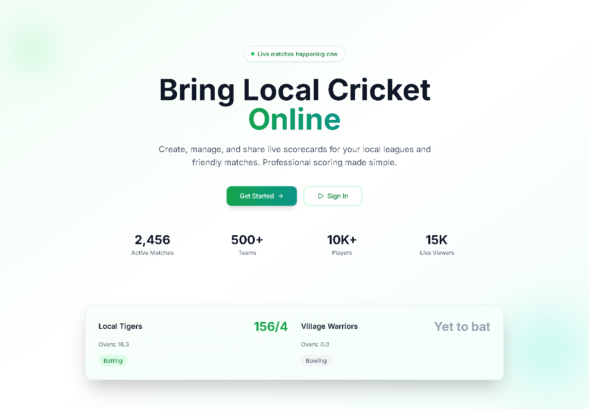
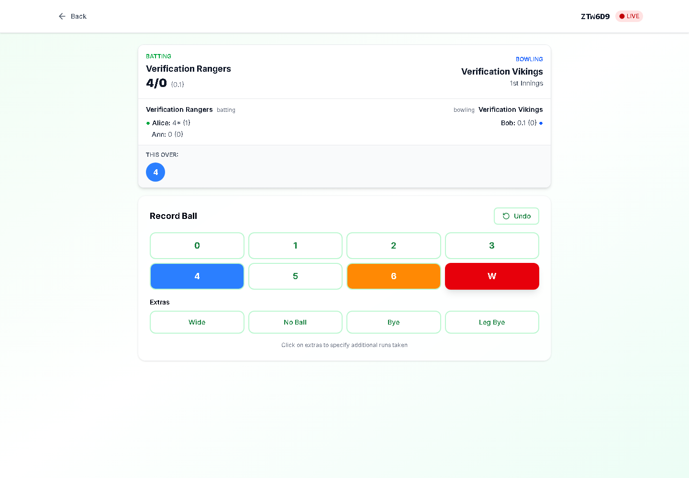

# CrickLive

[](https://github.com/MuhammadRaedSiddiqui/local-cricket-scorecard-app/actions/workflows/ci.yml)
[](LICENSE)

Create and manage local cricket matches, record every ball, and share live scorecards with players and spectators.

[Live app](https://cricklive-seven.vercel.app) · [Setup guide](docs/postgresql-setup.md) · [Verification](docs/verification.md) · [Contributing](CONTRIBUTING.md)



## Features

- Account registration and login with bcrypt password hashing and JWT cookies.
- Match creation, team/player setup, toss selection, and match-code joining.
- Ball-by-ball runs, wickets, extras, innings progression, and undo.
- Live scorecards and Pusher updates for match participants.
- Match dashboards and team, batting, and bowling leaderboards.
- PostgreSQL persistence, SQL migrations, and stale-update conflict checks.



## Stack

Next.js App Router, React, TypeScript, Tailwind CSS, PostgreSQL through `pg`, and Pusher. Aiven PostgreSQL is supported with verified TLS. Sentry monitoring is optional. The interface uses Inter.

## Run locally

Use Node.js **22 or 24** and npm. You need a PostgreSQL database and Pusher application settings.

```sh
git clone https://github.com/MuhammadRaedSiddiqui/local-cricket-scorecard-app.git
cd local-cricket-scorecard-app
npm ci
```

Copy `.env.example` to `.env.local` and fill in the database, CA certificate, JWT secret, and Pusher settings. Follow the [setup guide](docs/postgresql-setup.md) for Aiven connection details and secret generation.

```sh
npm run db:migrate
npm run dev
```

Open [localhost:3000](http://localhost:3000). On Windows PowerShell, use `npm.cmd` if script execution policy blocks `npm`.

## Check and build

```sh
npm run lint
npm run typecheck
npm test
npm run test:coverage
npm audit
npm run build
npm start
```

Database integration tests use isolated PGlite and do not connect to Aiven. Browser tests require a running app and an isolated database; see [verification instructions](docs/verification.md). CI runs lint, types, tests, dependency auditing, a production build, and browser checks.

## Deploy

Set the environment variables on the host, run migrations against its intended PostgreSQL database, then build and deploy. CA file paths from your computer do not exist on Vercel: use `DATABASE_CA_CERT` there. Public Pusher settings are compiled into the client, so rebuild after changing them.

Migrations initialize schema; they do not import historical MongoDB data. Never commit credentials, certificates, logs, or production data. The landing-page preview contains illustrative sample data.

## Project layout

| Path | Purpose |
| --- | --- |
| `app/` | Pages and API routes |
| `models/`, `lib/` | PostgreSQL repositories, authentication, scoring support, realtime clients |
| `db/migrations/`, `scripts/` | Schema migrations and verification tools |
| `__test__/`, `e2e/` | Unit, database, and browser tests |
| `docs/` | Setup, verification reports, and screenshots |

## Contributing and security

Read [CONTRIBUTING.md](CONTRIBUTING.md) and the [code of conduct](CODE_OF_CONDUCT.md). Report security issues privately using [SECURITY.md](SECURITY.md).

Licensed under the [MIT license](LICENSE).
